# Build with AI — Module 1: How to Learn AI

**Source:** Dymon AI Training (Superlinear) — Session 1, live Zoom recording
**Presenters:** Yuzheng Sun, PhD ("YZ") and Yan Wang, PhD ("Yaga") — Superlinear Academy; hosted by a Dymon Asia MD, Q&A moderated by Anna
**Runtime:** ~1h 51m
**Figures:** 37 screen-share slides and live-demo screenshots drawn from the recording

> This is a lightly cleaned, verbatim transcript of a two-part training session: Part 1 is a slide talk on *why AI is a paradigm shift and how to learn it* (Yuzheng Sun); Part 2 is a live agentic-coding demo with OpenAI Codex (Yan Wang); a moderated Q&A closes the session. Timestamps (`*[~MM:SS]*`) mark roughly five-minute intervals from the start. Obvious speech-to-text artifacts have been corrected for readability — e.g. "Dymon" (not "diamond"), "ChatGPT"/"Codex"/"Claude Code", "Andrej Karpathy's Software 3.0", "Mailchimp", "Bill Gates", "PDP-10", "Nokia N95", "Shunryu Suzuki", "Dymon MCP", and the presenters' names. Spoken content and phrasing are otherwise preserved.

## Table of Contents

- [Introduction: Why This Training](#introduction-why-this-training)
- [Part 1 — Understanding the Paradigm](#part-1-understanding-the-paradigm)
  - [Why AI Is Easy to Start but Hard to Master](#why-ai-is-easy-to-start-but-hard-to-master)
  - [The Three Challenges of a Paradigm Shift](#the-three-challenges-of-a-paradigm-shift)
  - [What Is a Paradigm? The iPhone Story](#what-is-a-paradigm-the-iphone-story)
  - [AI as the Third Interface to Compute](#ai-as-the-third-interface-to-compute)
  - [A Demo in Concept: Natural Language to Action](#a-demo-in-concept-natural-language-to-action)
  - [The Long-Tail Opportunity: Software 3.0](#the-long-tail-opportunity-software-3.0)
  - [Building Is the Best Way to Learn](#building-is-the-best-way-to-learn)
  - [We Are Still Early: The Mainframe Era](#we-are-still-early-the-mainframe-era)
  - [Ecosystems Take Time, So Stay Foolish](#ecosystems-take-time-so-stay-foolish)
  - [Coding as an Interface, Not a Career](#coding-as-an-interface-not-a-career)
  - [From Users to Builders](#from-users-to-builders)
  - [Learning AI: Mindset and Habits over Tools](#learning-ai-mindset-and-habits-over-tools)
- [Part 2 — From Chatbot to Agent](#part-2-from-chatbot-to-agent)
  - [Why an Agent, Not a Chatbot](#why-an-agent-not-a-chatbot)
  - [Meet Codex: Projects and Access](#meet-codex-projects-and-access)
  - [Demo 1: Renaming Messy Files](#demo-1-renaming-messy-files)
  - [Demo 2: Charting Price Data on a Web Page](#demo-2-charting-price-data-on-a-web-page)
  - [Demo 3: Overlaying News on the Chart](#demo-3-overlaying-news-on-the-chart)
  - [Demo 4: Reusing Work as a Skill](#demo-4-reusing-work-as-a-skill)
  - [Three Properties of an Agent: Ask vs Delegate](#three-properties-of-an-agent-ask-vs-delegate)
- [Q&A](#qa)
  - [Mapping Codex to Claude Code](#mapping-codex-to-claude-code)
  - [Cross-Agent Coordination Across a Team](#cross-agent-coordination-across-a-team)
  - [How to Double-Check the AI's Work](#how-to-double-check-the-ais-work)
- [Key Takeaways](#key-takeaways)

---

## Introduction: Why This Training

*[~5:00]*

**Host (Dymon Asia):** I've been interacting with the trainers here — Yan and YZ — for probably three or four months now. It was originally introduced by a mutual friend. I started reading Yan's work — he goes by **Yaga**, he has his own website and community — and I was impressed. They confirmed what I'd been suspecting myself: that AI in 2026 feels and looks very different from the AI I knew about in 2015, but I didn't quite know how to articulate it until I ran into these guys.

They run a community of about **2,000 AI builders**. It feels to me that this community is ahead by probably 18 months of everything I've been seeing out of Anthropic and OpenAI. They run a training program for corporations, and I've been working with them to custom-make this particular class. It's a **three-session** course. The main course is really Session 2, where you'll hear about the real value AI brings — it's not a smarter prompt or a better model, it's beginning the journey to train an AI agent that is *personal* to yourself, bringing your own context.

> If I hire an intern today, I want to train that intern over the next 10–20 years to think like me, to understand my thinking and my context. We'll promote a couple of methodologies Yaga's community has been pioneering — one is called **context infrastructure**, which we'll cover next session. I've also been promoting **Obsidian** as a knowledge base inside Dymon.

The hardest and most important thing is to **get started** — call it zero to one. Enough of my talk; handing over to you.

---

## Part 1 — Understanding the Paradigm

*[~8:00]*

**Yuzheng Sun (YZ):** I'm going to share my screen and use the slides. We've been teaching and iterating these across 12 different cohorts, updating the content each time, so this is really content that stands the test of time while staying relevant.

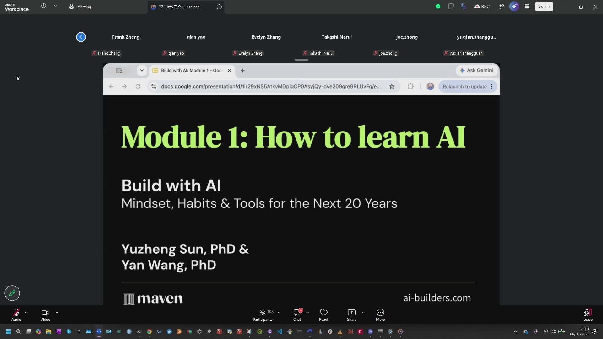

The purpose of this first session is more than just to understand AI. I'll talk about what AI is, but we also want to build a better way to *learn* AI and capture as many opportunities as possible. To do that we need to understand the essence of the technology as well as the best way to learn it.

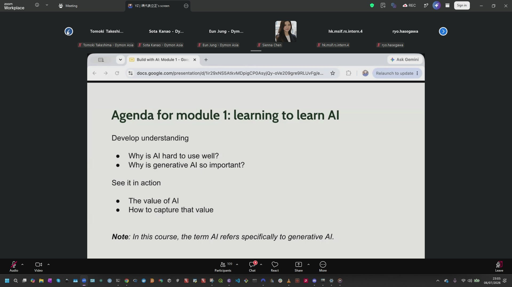

### Why AI Is Easy to Start but Hard to Master

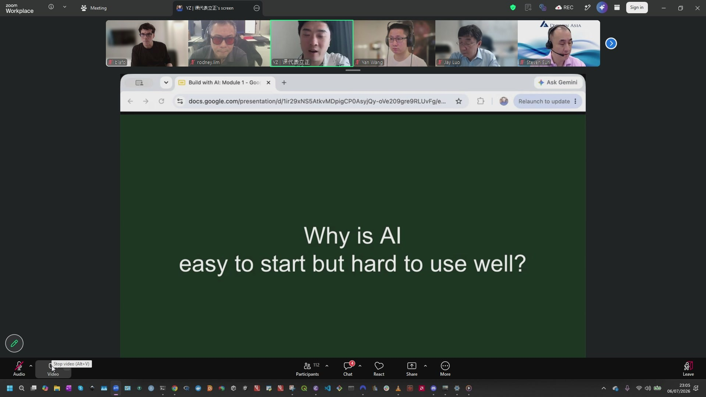

The core problem we all feel: **AI is incredibly easy to start, but frustratingly hard to use well.** Our course sells on Maven for $2,000 per person, and most people come because they resonate with the symptoms: *"I use chat but I feel stuck. I can't move beyond it. In my real workflow it's clunky and often fails. It's great for a demo but impossible to make reliable in production."*

*[~10:00]*

Beginners fail — and I can almost guarantee that if you pay close attention to our lessons, by the end you shouldn't feel this. You should feel that your mastery with AI is good enough to be reliable in production.

### The Three Challenges of a Paradigm Shift

The reason we experience those symptoms is that **AI is a paradigm shift.** Bill Gates said that in his entire life only two technologies struck him as revolutionary — the second is AI, and the first, equally important, was not the PC or the mobile internet: it was the **GUI**, the graphical user interface.

A new paradigm is disorienting. It brings challenges that are not just technical but cognitive and emotional, and they boil down to three:

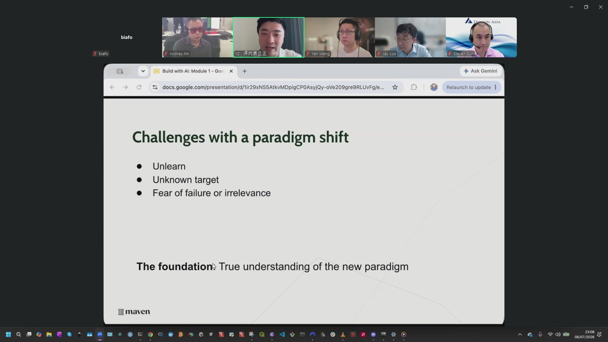

1. **We have to unlearn.** Old expertise can be a trap. A classic programmer's first instinct — "let's fine-tune the model" — is often the wrong approach with generative AI.
2. **Unknown target.** The old benchmarks are gone. We don't know what "good" looks like, and it's hard to separate signal from noise.
3. **Fear.** It's tough to go from being an expert to a beginner again. We hear programmers say the AI's code "is not good enough," but when we ask for evidence, most cannot provide any — the conclusion comes not from testing but from a **fear of being replaced.** That emotional resistance comes from fear of irrelevance.

To overcome these challenges, the foundation is to develop a **true understanding of the new paradigm.** If we don't understand it, we can't embrace it.

### What Is a Paradigm? The iPhone Story

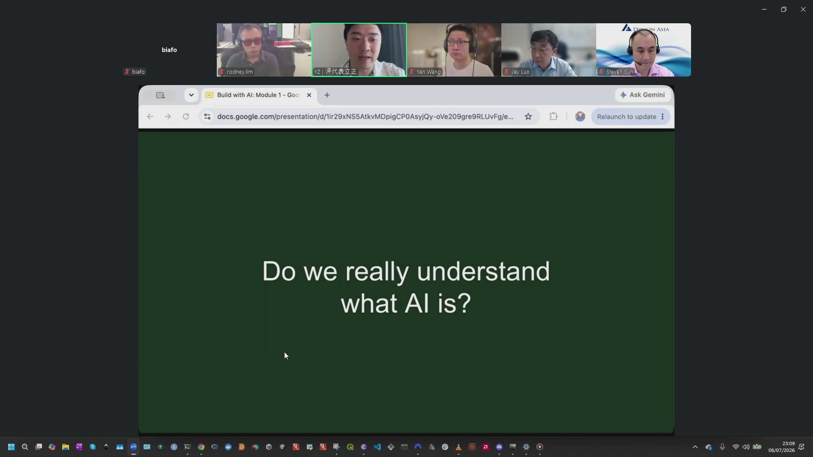

The root cause of the frustration is that we don't fundamentally understand what AI is. Some think it's just a new tool; others go to the extreme of thinking it's an intelligence that will replace humanity. Let's break down at least one important word: **paradigm.**

*[~14:00]*

Take a paradigm shift we all lived through — the **iPhone.** Most professionals here used a BlackBerry. (My first intern job was building an HTML file so a managing director could view data on his BlackBerry screen — one pixel off and it was all off.) So what was the shift of the iPhone? Why was it so much better than the competition?

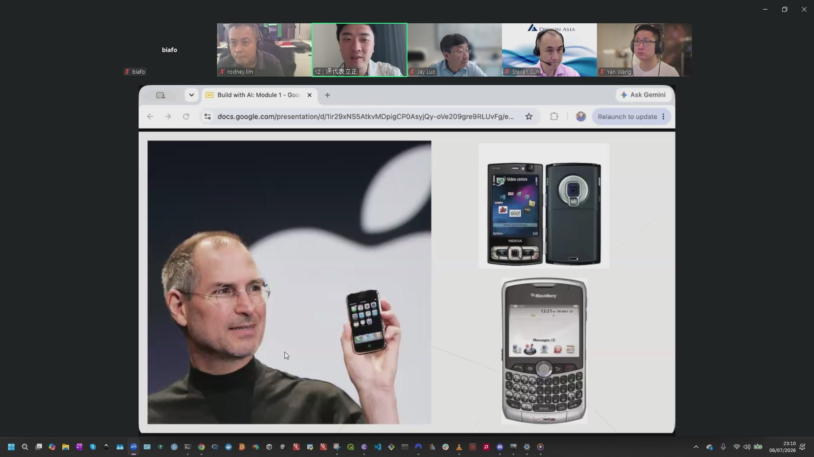

If you judged the first iPhone by the *old* rules, it wasn't impressive. A 2007 review found it worse than the **Nokia N95** — the strongest competitor at the time — in many categories. The iPhone wasn't first to 3G, and the Nokia had a better camera. But that comparison was **trapped in the old paradigm.**

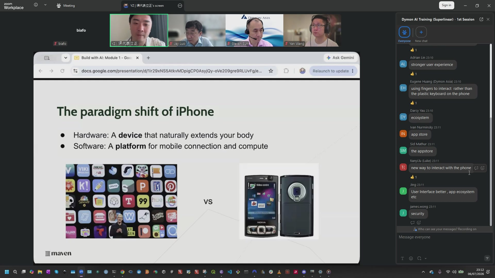

The audience nailed it in chat: the **App Store ecosystem.** The real shift was twofold. First, it was a device that was a **natural extension of our body** — no buttons, plus new sensors like the gyroscope. Second, it was a **platform** that gave everyone access to mobile connectivity and compute. Apple didn't build a taxi app; it built the platform that let Uber exist.

In year one, you could put the iPhone and Nokia side by side. In year ten, you cannot compare the entire ecosystems — there's no comparison. That's a paradigm shift: easy to name, hard to grasp the essence of.

### AI as the Third Interface to Compute

*[~17:00]*

So what is the paradigm shift of AI? Think about the value of *all* technology: it gives humans **access to compute.** Before AI we had two ways to do that:

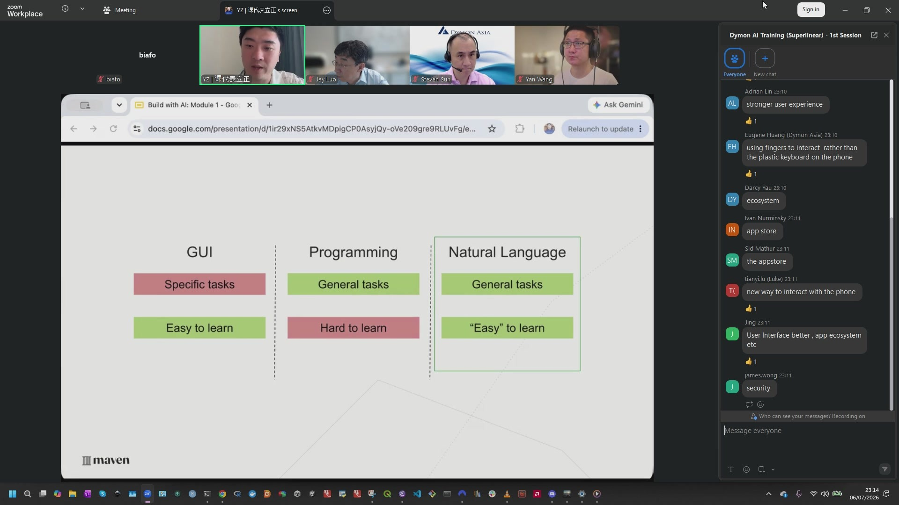

- **Programming** — very powerful, but very hard to learn and use.
- **The GUI** — very easy, but limited and expensive; someone has to build a button for you.

**AI is the third interface between humans and compute.** For the first time we can access powerful compute using **natural language.** That is the paradigm shift. This is why the GUI comparison from Bill Gates is so perfect: programming is general-purpose but hard; the GUI is easy but only for specific tasks; natural language is **both general-purpose and easy** — it breaks the old trade-off.

This is why we believe agents are so important, and why essentially all of our course is about how to use natural language to command compute to do things we couldn't do before.

### A Demo in Concept: Natural Language to Action

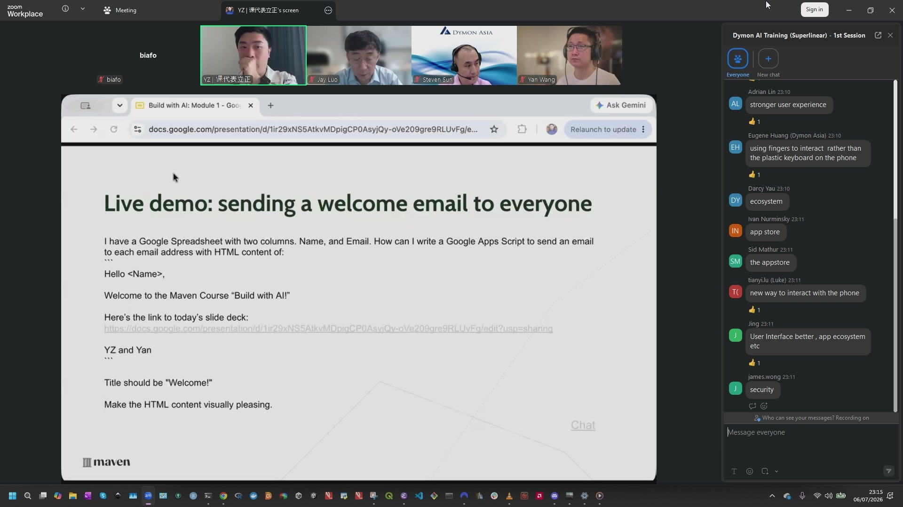

*[~19:00]*

We go to demos because real learning happens in a loop: **absorb, ponder, act.** Most people get stuck at "absorb." The barrier isn't a lack of information — it's a lack of action.

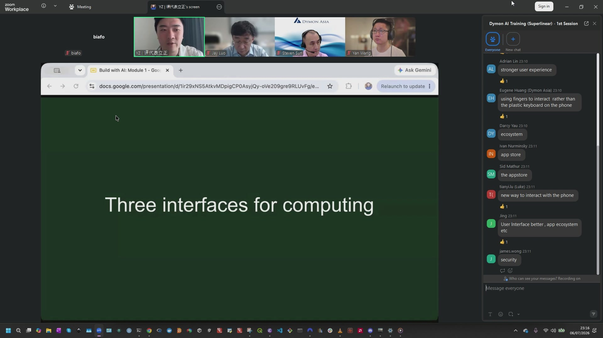

In my course I use a simple task: sending a personalized email to everyone in a Google Sheet of student names and addresses. I send natural language to ChatGPT asking for a script, run it through Google Apps, and everyone receives a personalized email.

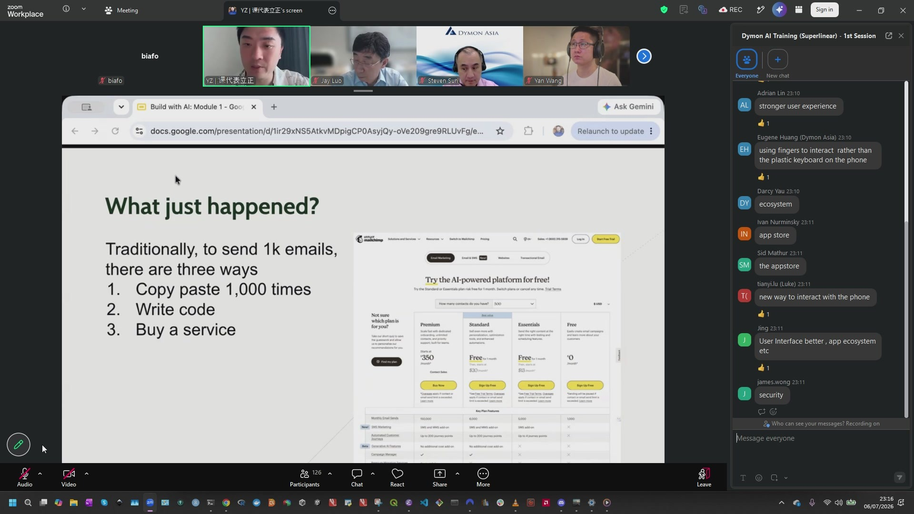

*[~20:00]*

In the old world I had three options for sending a thousand emails: (1) **manual labor** — copy-paste a thousand times; (2) **programming** — a high barrier; (3) **a GUI** — buy a pre-built tool. That third option is a massive business: **Mailchimp**, essentially "a button on an email script," was acquired for **$12 billion.** Why is a GUI so valuable? Because the task is valuable — measured by how much labor automation saves.

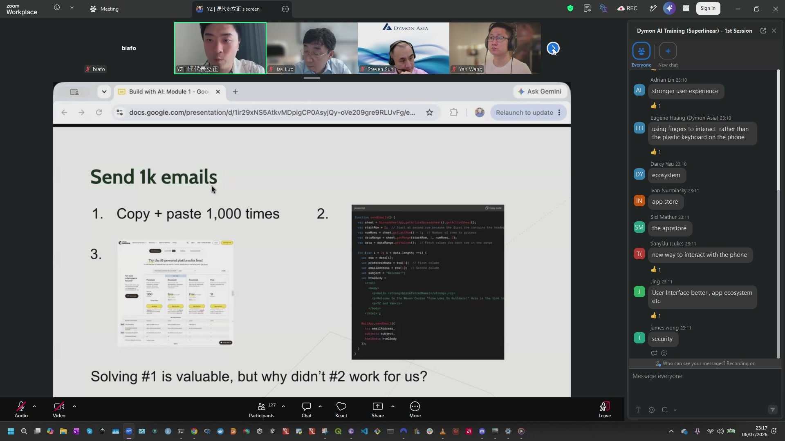

So why didn't option two — programming — work for most people?

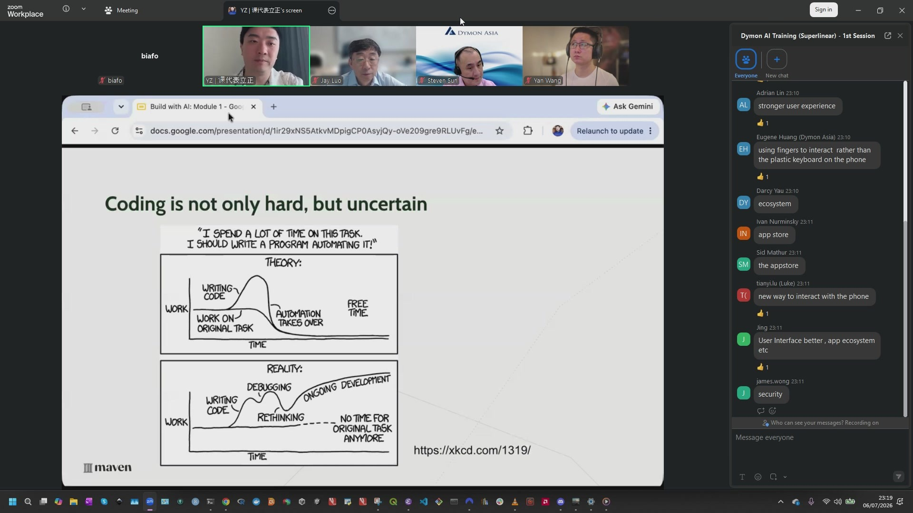

In theory, automation is a one-time investment: write the code, then you're free. In reality — as an old comic captures — we spend more time debugging the broken script. It's not just that programming is hard; the **time invested is uncertain.** Even for an experienced developer there's no certainty in how long a new task takes, and that uncertainty is the real high bar — it makes many tasks not worth solving with code.

### The Long-Tail Opportunity: Software 3.0

*[~24:00]*

Break all human demand into a 2×2: **productivity vs. entertainment**, **concentrated vs. long-tail.**

- Concentrated productivity → GUIs like Mailchimp, Windows, Excel.
- Concentrated entertainment → old web portals; long-tail entertainment → platforms like TikTok.
- The missing box is **long-tail productivity** — millions of small, customized tasks no one will ever build a GUI for.

Until now, nothing served that box well. Now we have **Software 3.0** — Andrej Karpathy's term for using natural language to write software. This is **user-generated software.** Just as concentrated entertainment was solved by professional content and long-tail entertainment by user-generated content, long-tail productivity is now solved by user-generated software. Those long-tail needs can matter more than the concentrated ones — think TikTok versus web portals — because long-tail demand follows a power law with no end.

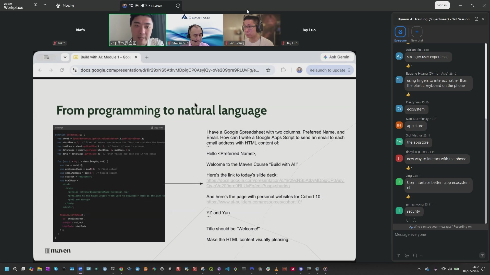

*[~26:00]*

We're moving from a world where you had to **write the code** to one where you just **describe the goal.** Helping you use natural language to access compute and solve long-tail productivity demand is the entire focus of our course.

### Building Is the Best Way to Learn

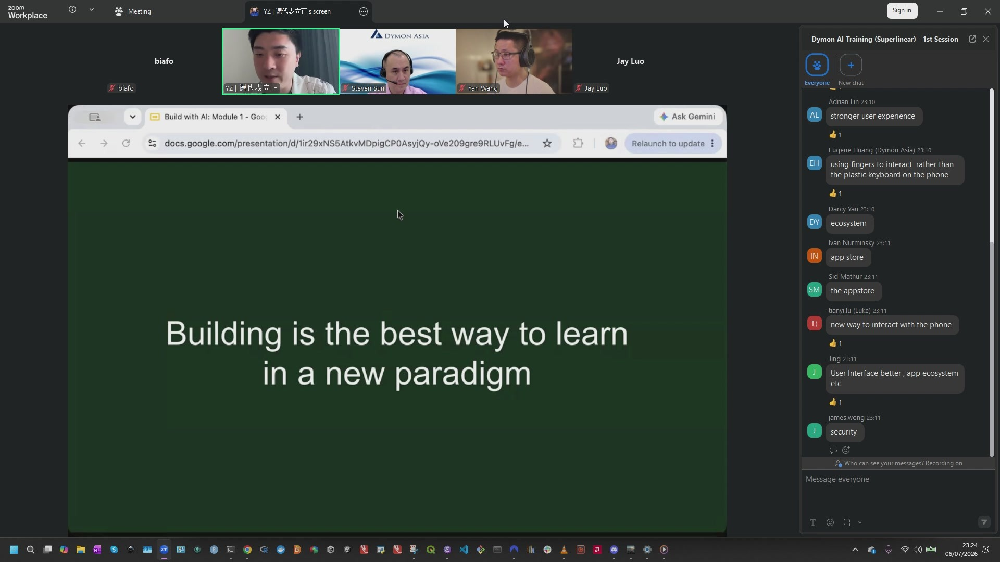

*[~27:00]*

I used to compare learning AI to **swimming** — you can watch 2,000 videos, but until you get in the water you'll never learn. My new analogy is **hiking**: you can buy all the expensive gear and look professional, but if you want to travel distance or conquer a hard mountain, you have to actually learn to hike — how to navigate, camp, pace yourself, conserve energy. Building is how you truly learn in this new paradigm.

In every past paradigm shift the winners had one thing in common: they weren't just users, they were **builders** — Gates, Zuckerberg, Musk, Bezos, Jobs.

### We Are Still Early: The Mainframe Era

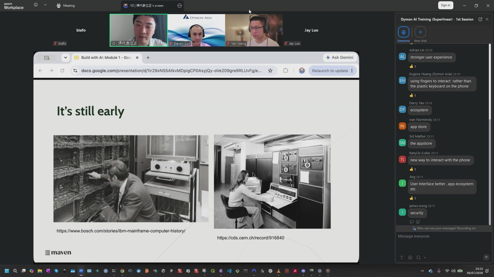

*[~29:00]*

But be clear — we are **very early.** We're not in the laptop era of AI; we're in the **mainframe era.** The tools are powerful but still raw. On the left is IBM's mainframe (the size of a room); on the right, the **PDP-10**-era machine — the size of a closet, but *accessible.*

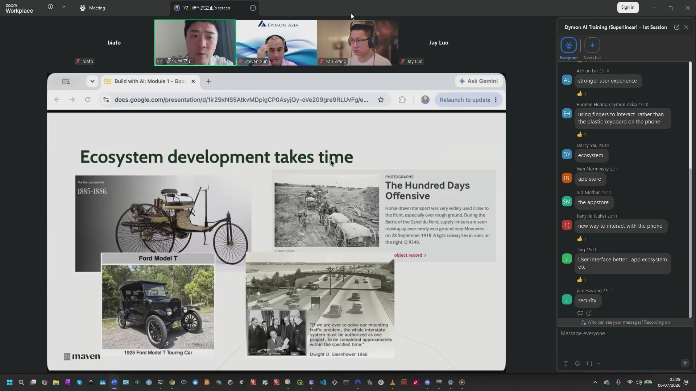

Bill Gates didn't just drop out of Harvard in 1975 when the Altair appeared. He'd been programming since middle school on a terminal with access to a PDP-10, founded a company in high school, and was a proficient programmer *before* Harvard. So when the Altair arrived, he and Paul Allen were ready. The anecdote: over 60 programmers approached the company promising a BASIC interpreter, but Gates and Allen were the only ones who actually built it — Allen even wrote the bootloader by hand on the flight to the demo. **The opportunity belongs to those who start building before everyone else.**

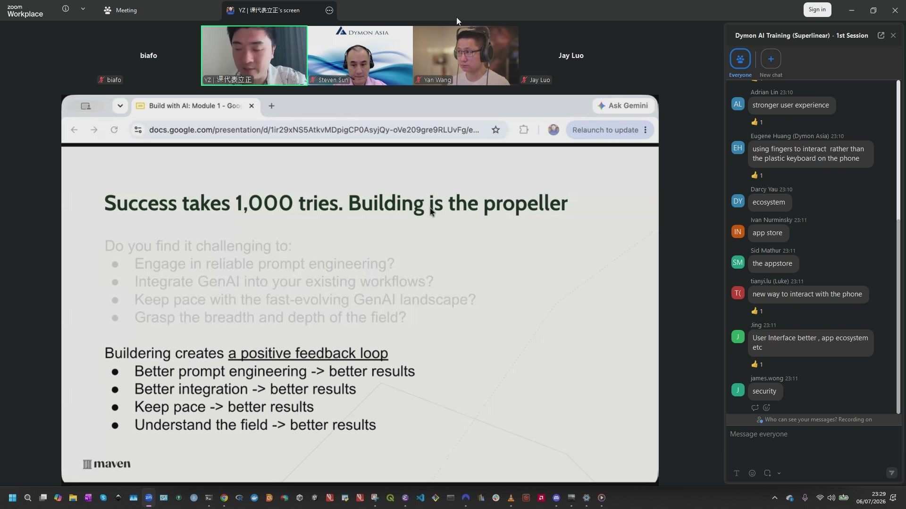

*[~32:00]*

Building is the single best way to learn, for two reasons. First, it's your **compass in a sea of hype** — the only question that matters is "does this new technology make *my* project work?" Second, building is your **propeller** — the satisfaction and dopamine of building propel you to keep iterating in a way no homework assignment could, helping you carve out an hour or two every day and stay consistent.

### Ecosystems Take Time, So Stay Foolish

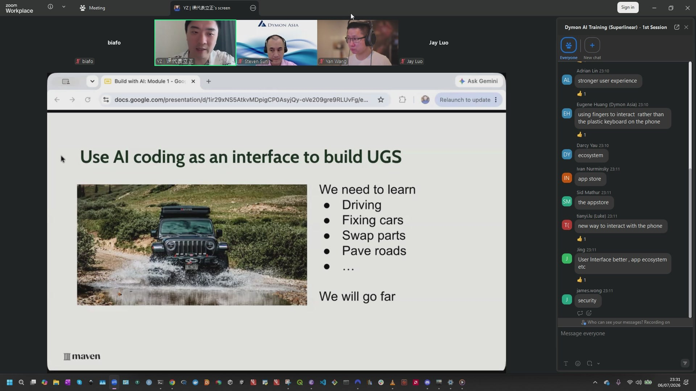

*[~33:00]*

We must be patient. The car was invented in the 1880s but took ~70 years to replace the horse — because you don't just need a car; you need gas stations, assembly lines, and transit infrastructure. Who opens a driving school when there are only two cars on the road? The ecosystem takes time to build; that's why we don't yet see AI replacing all old software. Development is slow at first, then crosses a threshold and replaces the old paradigm.

### Coding as an Interface, Not a Career

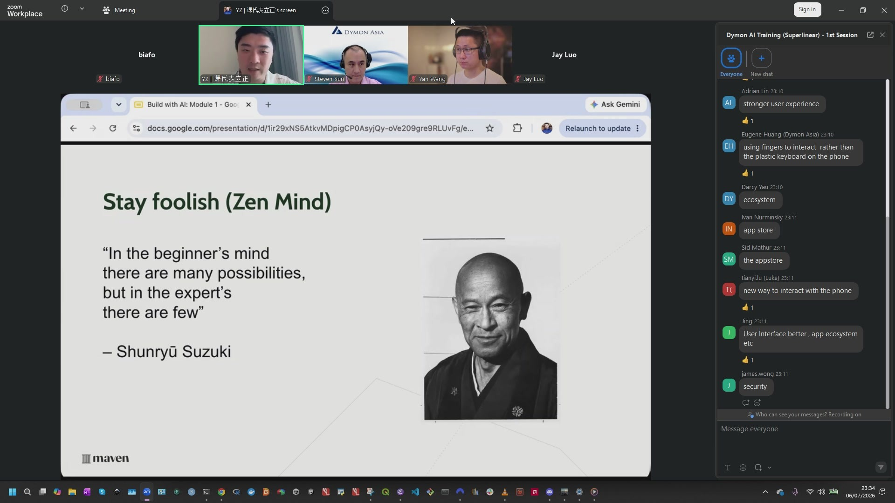

*[~35:00]*

This is a core idea: **we are not teaching you to become a coder.** Coding is not the purpose — it's the **general interface** to solve problems. You'll see agentic tools do a lot of coding, but the trillion-dollar internet industry is built on APIs and existing software, so we use AI to write code that **glues together existing APIs** to access compute.

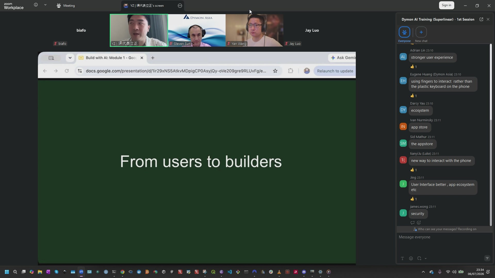

The AI has read the API documentation we haven't; it acts as a **universal translator.** The journey won't be smooth — but the challenges *are* the opportunity. If it were easy and one-shot, anyone could do it. The fact that you overcame ten errors where someone else gave up is your entire competitive advantage.

### From Users to Builders

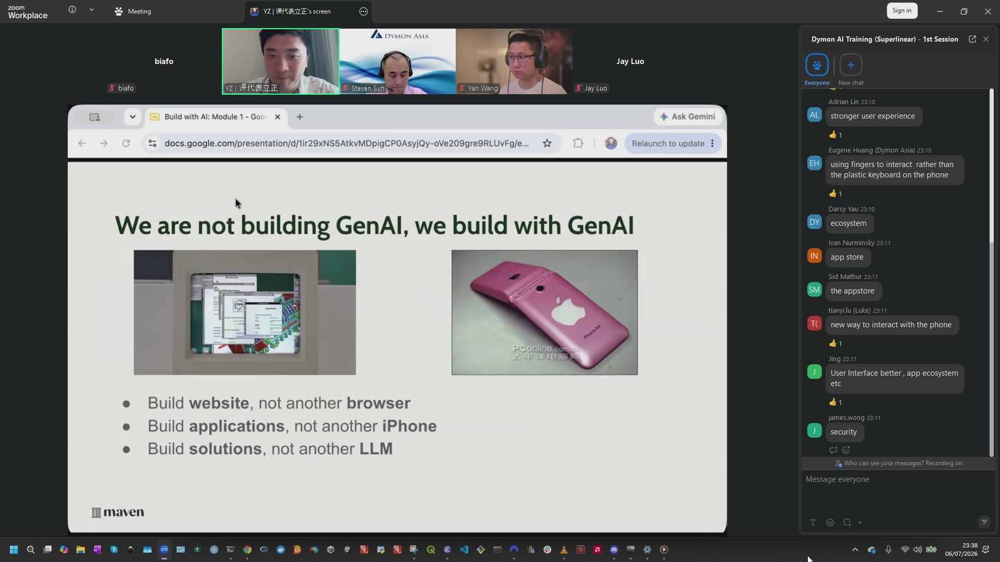

*[~37:00]*

That's why we must **stay foolish** and adopt a beginner's mind. Shunryu Suzuki: *"In the beginner's mind there are many possibilities, but in the expert's there are few."* In a new paradigm there is **no expert** — your sense of expertise is inherited from the old paradigm. Now is the time to unlearn.

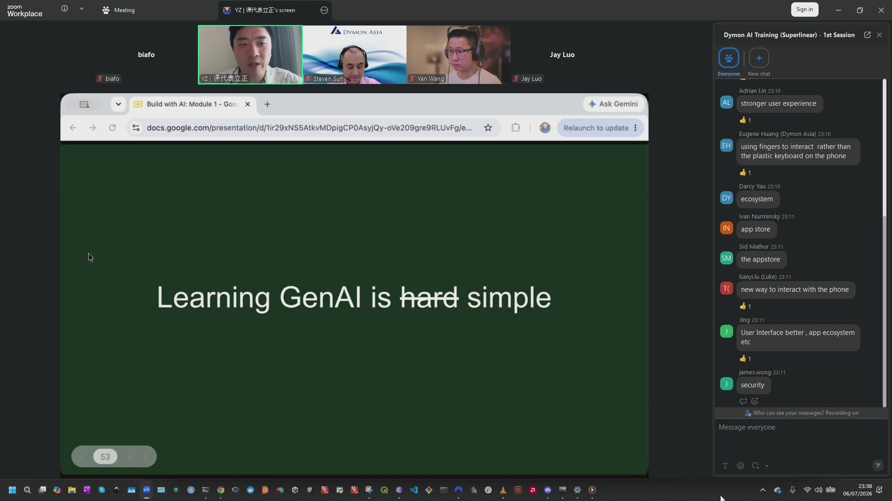

Our call to action: shift identity **from users to builders.** The user says "this app is bad"; the builder says "I can improve it." The user says "the app I need is missing"; the builder says "I can build it." When looking for problems, focus on the bottom-right quadrant — **valuable *and* disruptive** — because those opportunities require living in the new reality long enough to see them.

### Learning AI: Mindset and Habits over Tools

*[~42:00]*

Learning is hard, but the process is simple. Most people think they're behind because they don't know enough terms, tools, or frameworks — but that's usually **not** the real bottleneck. The gap isn't who can explain RAG; it's who can break down a messy task, manage context, decide what AI should do versus the human, diagnose failures, and keep iterating. **Execution is the real advantage.**

This is why the course focuses on frameworks that make AI reliable in practice. There are **five gaps**:

1. **Output/context gap** — better prompting isn't the answer; what matters is whether AI sees the right context, constraints, standards, and prior decisions.
2. **Quality gap** — when output is bad, weak users just retry; strong builders diagnose the actual cause (missing context, saturated context, ambiguous instructions, model limits).
3. **Delegation gap** — most people supervise AI like a fast intern; move toward handing off complete tasks with clear goals, boundaries, and checks.
4. **Compounding gap** — without a system, every good result is a one-off and every mistake repeats; turn experience into reusable assets and team memory.
5. **Leverage gap** — once the first four are in place, AI becomes a real thought partner that helps you reason and surface blind spots.

*[~45:00]*

It comes down to a hierarchy: **tools → methodology → habits → mindset.** Focus on mindset and habits, and everything else follows. The recipe to keep going: **make something people want** — discover a problem, build a solution, overcome challenges, find a market, repeat. The end of this course is just the beginning of your real learning.

**To summarize Part 1:** AI is hard because it's a new paradigm; the paradigm is *natural language as an interface to compute*; the best way to learn is to build; we're early, so challenges are opportunities in disguise; focus on the builder's mindset and habits, build something people want, and stay foolish. (Session 2 covers production tasks; Session 3 covers building your compounding system.)

---

## Part 2 — From Chatbot to Agent

*[~48:45]*

**Yan Wang (Yaga):** YZ introduced a lot of helpful mindset transitions. The very first practical step is simple: **stop using the ChatGPT or Gemini app; use an agent instead.** It's much easier than people think, and that's the theme of my part.

### Why an Agent, Not a Chatbot

*[~49:00]*

Think about what you get with ChatGPT: a chat box. The AI responds in text, but it **cannot preserve your preferences, cannot touch your hard disk, and cannot perform actions for you.** In this presentation we'll spend about an hour showing four important differences, so that next time you want to do something with AI you have the muscle memory to **open Codex rather than open ChatGPT.**

We'll do four demos: (1) rename ten files you don't have the patience to rename by hand; (2) draw a chart from Excel; (3) let the AI fix its own errors — it has its own eyes and hands, so it sees an error message and fixes the code without human back-and-forth; and (4) capture a preference and keep it, by saving it to a local file.

### Meet Codex: Projects and Access

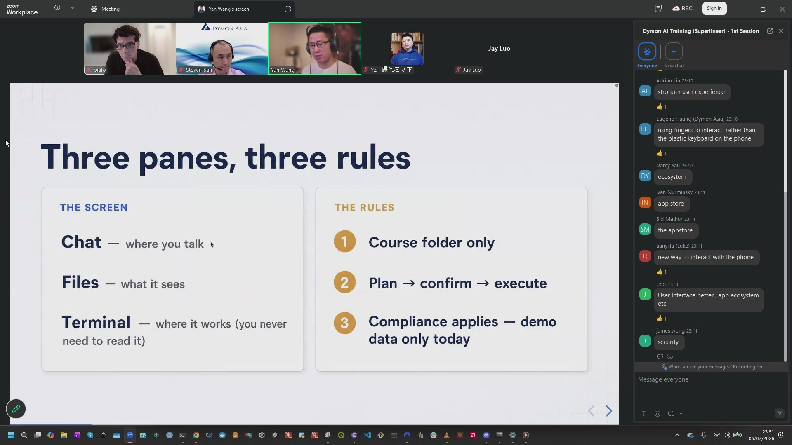

*[~52:00]*

This is an agent-based tool — here, **Codex** — but feel free to use Cursor, Claude Code, or Google's Antigravity; they have very similar interfaces and are largely interchangeable. I use Codex because it's the most compliant option inside Dymon. On the left is a list of conversations; on the right, a chat window.

The key difference from ChatGPT is a **project**: unlike a chatbot, Codex can put its hands on your hard disk. You choose a folder as the project (here, the unzipped Session 1 handout), which means the AI can access files *within* that folder and generally won't touch files outside it — a clear boundary that matters for compliance and keeps projects from polluting each other.

*[~54:00]*

The other concept is the **access level** (the orange "Full access" control). There are three settings: **ask for approval** (conservative — every change needs explicit authorization); **approve-for-me/auto** (the AI approves generally safe actions like browsing or copying files, and flags anything risky); and **full access** (it can even delete data). It's wise to start conservative and open up as you learn the boundaries; for this demo we'll use full access for efficiency.

### Demo 1: Renaming Messy Files

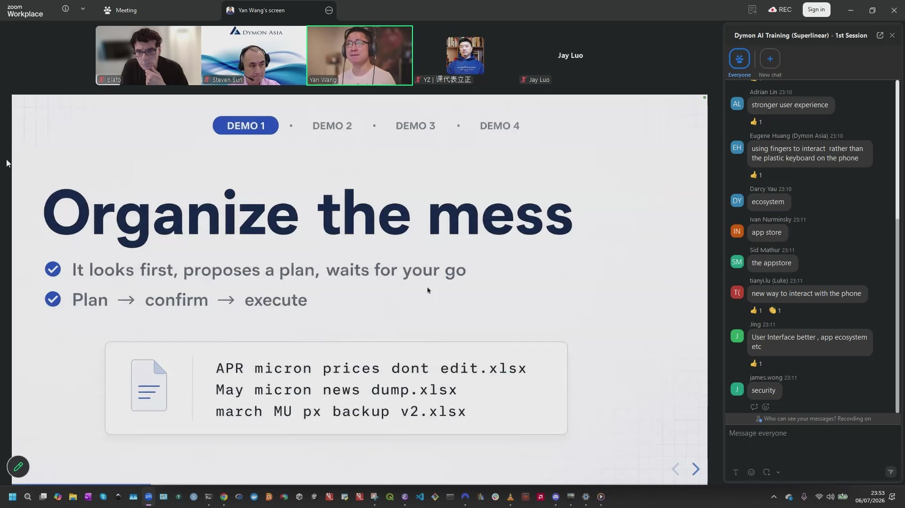

*[~55:00]*

In our handout there are six Excel files scraped from Yahoo Finance via the **Dymon MCP** — price bars for the ticker **MU** (Micron) plus the ten most important news articles with timestamps, titles, summaries, and URLs. They have weird names like "HBM headlines April copy," and we want to rename them for a clean workspace.

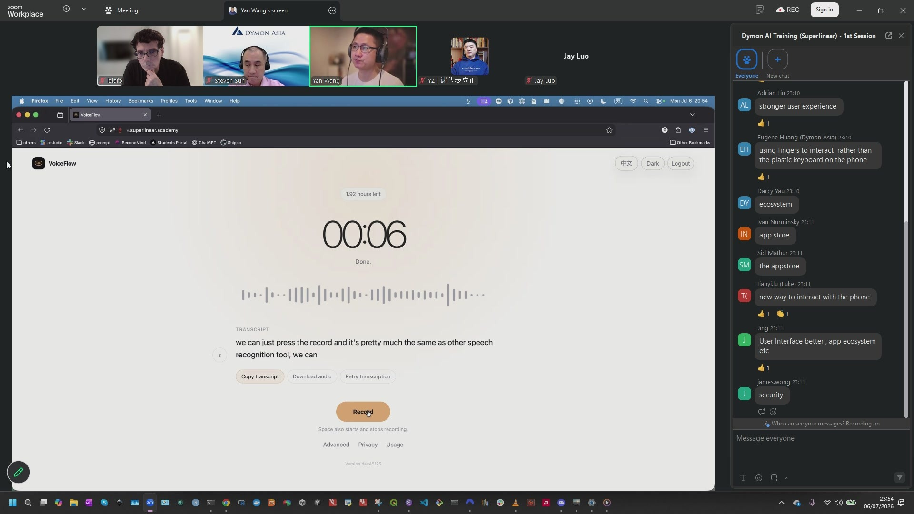

*[~57:00]*

A quick tip: **prompt quality often correlates with length.** Telling the AI *why* — as you would with an intern — helps it grasp the nuances. A trick to make prompting easier is to **use speech recognition instead of the keyboard** (we ship one with superlinear.academy). I point Codex at the `demo_inputs/incoming` folder and ask it to inspect the files. (A copy-paste hiccup here was a quirk of the remote Dymon machine, not the AI.)

*[~60:00]*

Codex looks through the folder, finds six Excel workbooks, inspects their contents, and notices the naming quirks itself. I then queue the next prompt — "rename the files to something like `2026_02_price.xlsx`, `news`, etc." (**queueing** is a Codex feature: you can line up prompts and even reorder them while it works). It figures out the exact names and formats and **renames all files at once.** This is exactly what YZ described: instead of writing an error-prone program or hunting for a specialized batch-renamer, we invoke computing power with natural language. Codex still writes code — but it's transparent to us; we never touch Python or the terminal.

### Demo 2: Charting Price Data on a Web Page

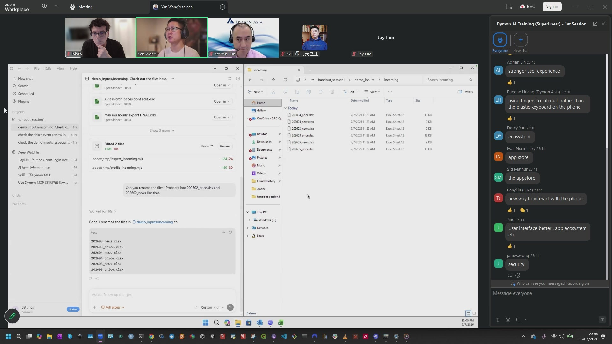

*[~64:00]*

Next step: visualize the hourly price bars as a chart. I ask, "plot a chart of the price for all the months, on a web page" — no need to specify HTML, editors, or hosting. I switch the **reasoning effort** to medium (a setting: higher is slower and probably smarter; medium or light is faster and cheaper and fine here). Codex even sanity-checks whether the timestamps are UTC or local.

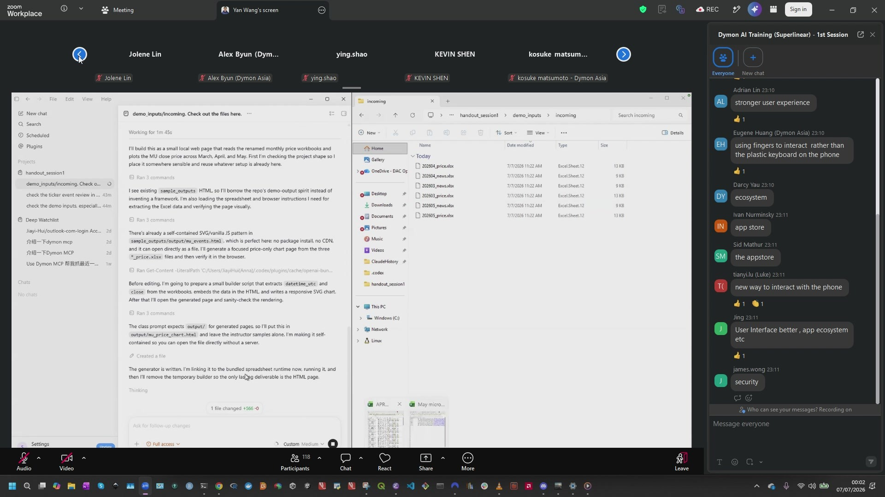

*[~66:00]*

It writes the output to `output/mu_price_chart.html`, tries to open the browser, is blocked by a security setting, and then figures out how to open it anyway. The result is an interactive chart — you can hover for details and filter by month — a very different experience from Excel.

### Demo 3: Overlaying News on the Chart

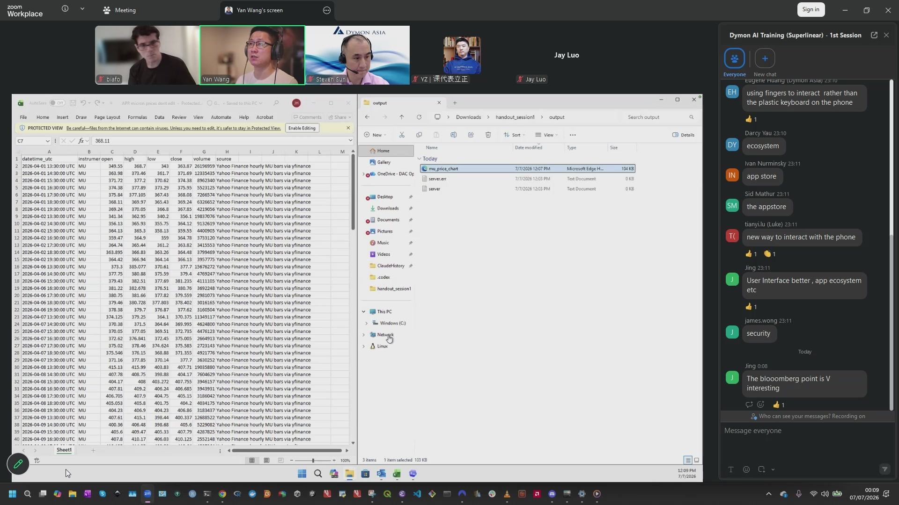

*[~68:00]*

To understand *why* prices moved, we overlay the news on the chart. I ask for the news articles to be rendered as **clickable dots** that show a summary and a link to the source. Notice Codex now **interacts with the web page itself** — that's its cursor, not mine — clicking elements and using vision to verify the result satisfies the request. It combines capabilities from multiple tools into one comprehensive task. When it hits an error, it **reads the message, adjusts its own program, and reruns** — where ChatGPT would make you paste the error back and forth.

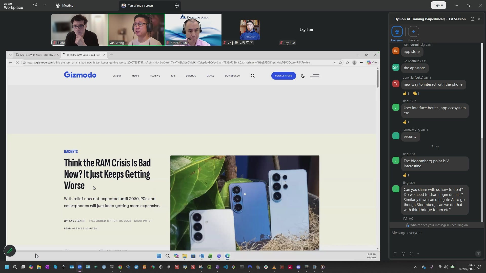

*[~71:00]*

This is a full-fledged browser: you could have it open Bloomberg, log in, and operate on your behalf, or gather data from various sources. (The app crashed once — a good chance to show **resuming a session**: reopen the browser or double-click the generated `mu_price_chart.html`.)

*[~74:00]*

Reviewing the overlay: I like that it renders correctly, but I don't like that the **y-axis starts at 200, not zero**, which magnifies the trend. So I ask it to replot from zero — that's a *preference*. I also ask it to keep only earnings-related news and discard the rest, since 30 articles is too many to analyze.

### Demo 4: Reusing Work as a Skill

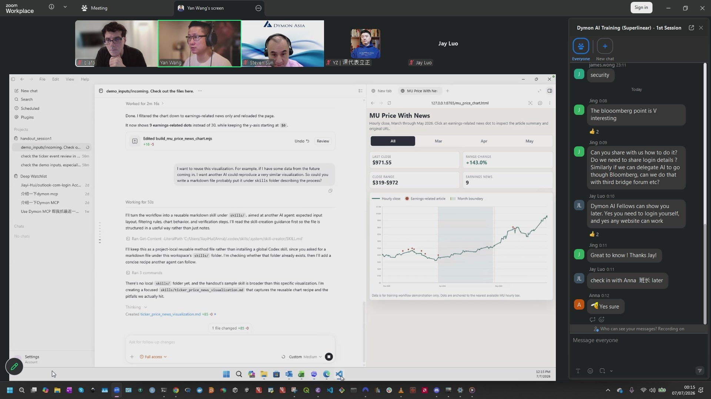

*[~78:00]*

Now the important part: **reuse.** With a plain chatbot, future data (say June's numbers) would forget my preferences (y-axis from zero, earnings-only). So I ask Codex to serialize the whole process into a **skill** — a Markdown file under a `skills/` folder describing the method: "a reusable method for turning monthly ticker-price files plus monthly news files into a single self-contained HTML chart."

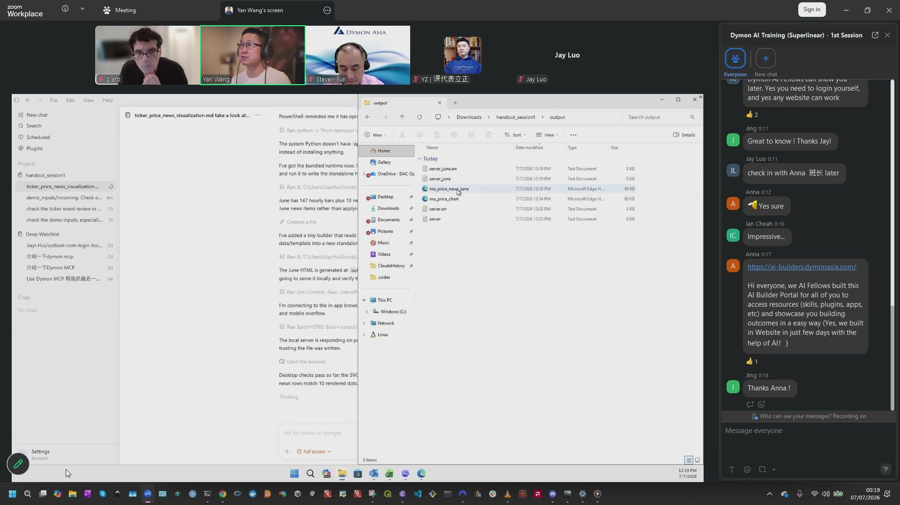

*[~81:00]*

To test it, I start a **brand-new session** (no memory of the prior conversation) and use the `@` feature to hand it just that skill file plus June's data. It reads the file, reproduces a consistent chart, and remembers the corrections. When a couple of non-earnings articles slip through, I use the **steer** button to interrupt and tighten the filter to "Micron earnings-call" news, then have it update the skill and redo the task — regenerating and verifying. All of this is reusable and adheres to the original corrections.

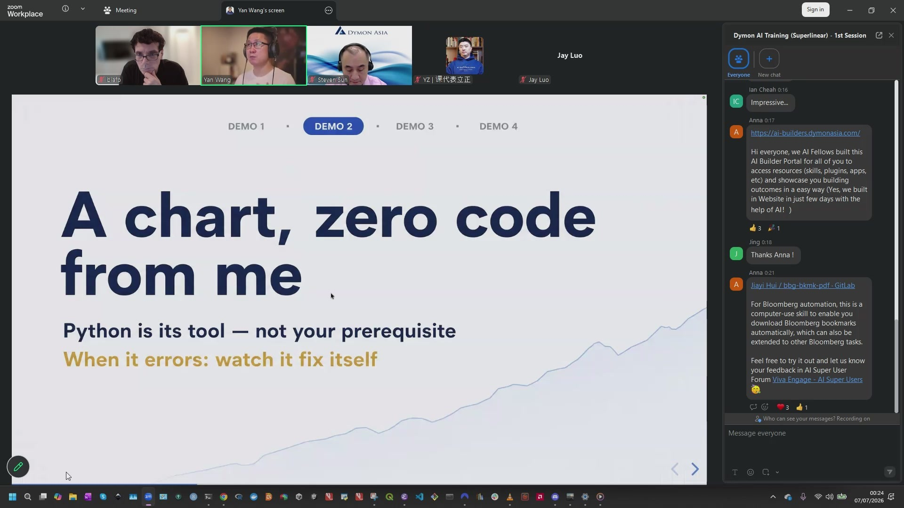

*[~88:00]*

This matters because it lets us reuse everything with AI, especially alongside a knowledge base like **Obsidian**: today we have one skill, but imagine the hundredth — they interconnect. A common worry is that using AI makes you *less* competitive by distilling your capabilities. The opposite is true: off-the-shelf models are trained on **consensus**, and there's no alpha in consensus. Giving the model *your* preferences and context makes it **your** AI — a compounding, contrarian asset that makes you *more* differentiated the more you use it.

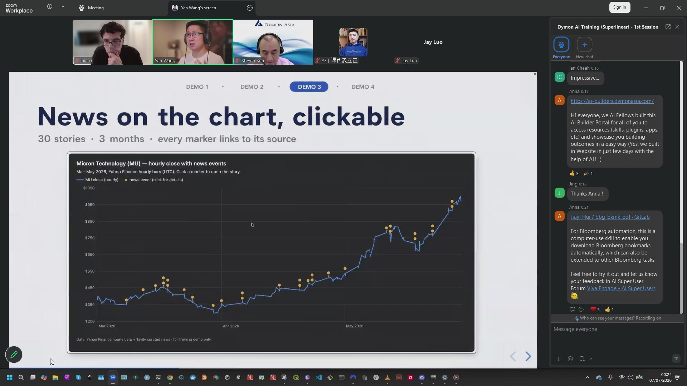

*[~90:00]*

How is this different from Bloomberg's "news on chart"? **We own the product** — the data, the settings. When we dislike how the y-axis renders or how news is picked, we just ask, and immediately get what we want. With Bloomberg you'd submit a feature request and wait years. We can also supply our own context and reports, establishing a **data flywheel.** All the data comes from the **Dymon MCP**, a natural-language way to access information within Dymon — ask the AI fellows to set it up (contact `aibuilders@dymonasia.com`).

### Three Properties of an Agent: Ask vs Delegate

*[~95:00]*

Before I end, three basic properties of an **agentic AI**: (1) it can **use tools** — Excel, Python, HTML, whatever; (2) it can **combine multiple tools** to finish a complicated task; and (3) getting things done is not "aesthetic" — it **inspects the result and changes its next step** accordingly, forming a loop.

So the ask: **don't use ChatGPT — delegate the task to Codex**, so it has *eyes* on your local files and *hands* to execute on your behalf. Homework: use your own ticker and the same loop, feel the "new-session" moment, and have it write your reflection.

---

## Q&A

*[~98:00]*

**Anna (moderator):** Thank you, Yuzheng and Yaga. Diamond Knights, please type questions in the chat, or turn on your camera and mic.

### Mapping Codex to Claude Code

*[~99:00]*

**Q — Anna:** Some colleagues use Claude Code. Can you briefly show how the panels map between the two apps?

**Yan Wang:** Claude Code looks very similar to Codex. The one thing to watch is the three tabs — don't go to the wrong one: **"chat"** is the traditional chat window, **"code"** is the real Claude Code. The project concept, the chat box, and the modes all correspond: **auto = "approve for me," bypass permissions = full auto**, plus a model selector and reasoning effort. Both Codex and Claude Code also have a **remote** feature in settings (for Claude Code, remote control is on the personal plan).

### Cross-Agent Coordination Across a Team

*[~102:00]*

**Q — Lan Zhou:** Any best practices for cross-agent coordination across colleagues — vault setup, `.md` file editing, etc.?

**Yan Wang:** Two mechanisms. First, **team-level skills** — procedures like collecting data from certain roles, redistributing it, and building a dashboard — shared via shared network storage or a GitHub/GitLab repo. Second, **sharing an individual skill** with colleagues via a **marketplace for skills** (I already publish ready-to-use skills on my GitHub; it's trivial to host this internally for people to upload and share). A third, early-stage direction is talking directly to a colleague's agent (e.g., when they're asleep or in another time zone) — still exploratory.

### How to Double-Check the AI's Work

*[~105:00]*

**Q — Mincy:** In the renaming example, how do I know it didn't mislabel a file, or that the data isn't made up?

**Yan Wang:** Two aspects. First, **trust, like with a new intern** — at first you inspect every task in detail; over time you learn which tasks are within your comfort level (renaming is, for a capable model) and which sit at the boundary and need attention. Start conservative and double-check; you'll get "backfired" occasionally, and that's how you recalibrate. Second, **cross-check vs. double-check**: double-checking means redoing the task; cross-checking means pulling data from different sources and using experience to see if the numbers look right. Experienced managers cross-check, because double-checking everything makes the manager a bottleneck. I also explicitly ask the AI to **present information so it's easy to verify** — our bandwidth is precious.

*[~108:00]*

**Yuzheng Sun:** This is important. Models hallucinate, but our tasks are critical, so we can't afford mistakes. The general principle: **trust the process, not the "brain."** LLMs do probabilistic next-token prediction, so they *will* hallucinate — but when you use the model's brain to **write code or generate a process**, mistakes get surfaced, and the agentic loop feeds them back so the model can spot and avoid them. In the chart example, the model **wrote the code** that plotted the data; it didn't generate the data from token prediction. If the code is correct — and passes a cross-check — I can trust the results, just as I'd trust a human who writes correct code without understanding every neuron in their brain. Develop the *process* so the result is trustworthy.

*[~110:00]*

**Anna:** With five minutes left, a quick promotion for the next sessions. **Session 2 (July 13) — context infrastructure:** build a personal agent and learn that it's memory and context, not a clever prompt, that make AI compound on your own work. **Session 3:** design your own skills and manage the AI like a capable junior. If you don't have the calendar invites, reach out and I'll send them.

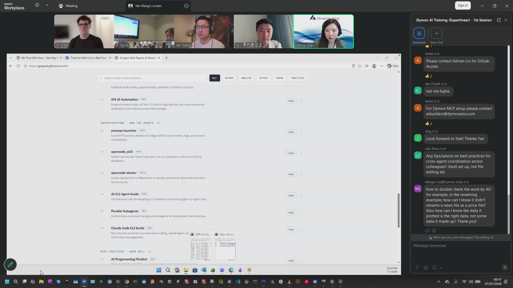

Thank you, Yuzheng and Yaga, and thank you to every Dymon Knight who joined this AI training session. See you next time.

---

## Key Takeaways

| Concept | Summary |
|---------|---------|
| AI is a paradigm shift | Like the GUI and the iPhone, its value isn't visible through old benchmarks; it must be understood on its own terms. |
| The third interface | Programming is powerful-but-hard; GUIs are easy-but-limited; **natural language** is both general-purpose and easy — a new interface to compute. |
| Software 3.0 / long-tail | Natural language unlocks **user-generated software** for the millions of long-tail productivity tasks no one builds a GUI for. |
| Build to learn | Building is both a **compass** (does it make *my* project work?) and a **propeller** (the dopamine that sustains daily practice). |
| We are early | This is the mainframe era of AI; the ecosystem takes time. Early builders capture the opportunity — as Gates did with the PC. |
| Mindset over tools | The hierarchy is tools → methodology → habits → mindset. Close the five gaps (context, quality, delegation, compounding, leverage). |
| Agent, not chatbot | An agent has **eyes and hands**: it reads your files, runs and fixes its own code, and persists preferences. Delegate, don't just ask. |
| Skills = compounding assets | Serialize preferences and processes into reusable **skill** files so an off-the-shelf model becomes *your* differentiated, contrarian AI. |
| Trust the process | Models hallucinate, so use them to **write code / generate a process**, then cross-check. Trust verifiable output, not the "brain." |
| From users to builders | "This app is bad" → "I can improve it." "The app I need is missing" → "I can build it." Stay foolish; keep a beginner's mind. |
